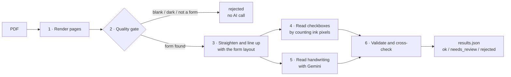

# Construction Form Digitizer

This project reads scanned, handwritten safety observation forms and turns them into clean, validated JSON. It also says clearly what it could not read, instead of guessing.


Sample_input.pdf  ->  python -m form_digitizer  ->  output/results.json


## Results on the sample PDF

- Page 1 is `ok`. Every field was read, and both checkbox readings agree.
- Page 2 is `needs_review`. The AI read the location as 2000, while the pixel count read 1000, which is the correct value. The pipeline flags the disagreement instead of picking one silently.
- Page 3 is `ok`. Every field was read, and both readings agree.
- Page 4 is `rejected`. It is the "FAILED TEST FORM" page, so it is rejected before any AI call. That costs nothing and leaves nothing to hallucinate from.

I checked every value on pages 1 to 3 by hand against the PDF.

## Contents

1. [Getting started](#1-getting-started)
2. [How it works](#2-how-it-works)
3. [Design principles](#3-design-principles)
4. [The pipeline step by step](#4-the-pipeline-step-by-step)
5. [Resilience strategy: handling bad input](#5-resilience-strategy-handling-bad-input)
6. [AI configuration](#6-ai-configuration)
7. [Output format](#7-output-format)
8. [Cost and speed](#8-cost-and-speed)
9. [Project structure and settings](#9-project-structure-and-settings)
10. [Tests](#10-tests)
11. [What I learned while building it](#11-what-i-learned-while-building-it)
12. [Limitations and next steps](#12-limitations-and-next-steps)

## 1. Getting started

### Install

You need Python 3.10 or newer.

```bash
python -m venv .venv
# Windows: .venv\Scripts\activate      macOS / Linux: source .venv/bin/activate
pip install -e ".[dev]"
```

### Add an API key (optional)

Copy `.env.example` to `.env` and paste in a free Google AI Studio key from <https://aistudio.google.com> (look for "Get API key"). The `.env` file is git-ignored, so the key never gets committed.

```
GEMINI_API_KEY=your-key-here
```

### Run

```bash
python -m form_digitizer                            # reads data/Sample_input.pdf, writes output/results.json
python -m form_digitizer my.pdf -o out.json         # any other PDF
python -m form_digitizer --debug-dir output/debug   # also saves each page and its straightened version
```

### Running without a key

It still works. The AI replies for the sample PDF are saved in `output/cache/` and committed with the repo, so a run without a key gives the same results. On a new PDF without a key, the checkboxes are still read because that part doesn't use AI. The text fields come back empty and the pages are marked `needs_review`.

## 2. How it works



Every checkbox is read twice, independently. Step 4 counts pixels, step 5 asks the AI, and step 6 compares the two. Handwriting is read only by the AI, and its output is then checked for format.

## 3. Design principles

1. Never return a confident wrong answer. A blank field with a flag is better than a guess that looks right. Every value is either trusted or flagged for a person to check.
2. Use AI only where it's needed. Whether a box has an X in it is a pixel-counting problem, which is free, instant and repeatable. The AI does the one job it's best at here, reading handwriting.
3. Reject garbage before spending money on it. Blank, black and non-form pages never reach the AI.
4. Check everything twice. Checkboxes get two independent readings, dates and ID numbers are format-checked, and the AI's reply is validated against a schema instead of being trusted.
5. One bad page never stops the batch. A failure on any page becomes a flagged page, not a crash.

## 4. The pipeline step by step

### Step 1: Render the pages

File: [`pdf_loader.py`](src/form_digitizer/pdf_loader.py)

Each page becomes a 200 DPI grayscale image. That is sharp enough for X marks and handwriting while still being fast to process. Pages are streamed one at a time, so even a 500-page PDF doesn't need to fit in memory.

Any text built into the page is kept as well. That is how page 4 gives itself away: it contains the text "FAILED TEST FORM", while the real scans contain no text at all.

### Step 2: Quality gate

File: [`quality.py`](src/form_digitizer/quality.py)

Four cheap measurements decide whether a page is worth processing:

- Ink ratio, the share of dark pixels. It catches blank pages (close to 0%) and pages that are black or covered in mud (over 70%).
- Grid lines, the number of long straight lines at any angle. It catches pages that aren't the form. Page 4 has 0 of them, while real forms have about 108.
- Sharpness, how much the image changes between neighbouring pixels. It catches blurry scans.
- Skew, the typical angle of those lines. Step 3 uses it to straighten the page.

The rule is simple. If the form's table grid is still visible, the page is processed and whatever is wrong with it gets flagged. If the grid isn't visible, the page is rejected. A muddy but readable form still produces data, and only the fields under the mud come back empty.

### Step 3: Line the page up with the form

Files: [`alignment.py`](src/form_digitizer/alignment.py), [`layout.py`](src/form_digitizer/layout.py)

After this step, every checkbox sits at the same pixel position on every page.

I didn't overlay `template.jpg` because I measured it first and it doesn't match the real forms. The template is a stretched 752×1600 phone image with 15 checklist rows. The real forms are A4, with 8 or 9 rows and a gap before the bottom section. So every box position was measured once on a clean real page and stored in `layout.py`. Supporting a new form version means adding a layout there, with no pipeline changes.

A page is lined up like this:

1. Rotate it by the skew from step 2. The pipeline also tries 90°, 180° and 270°, which handles sideways and upside-down scans.
2. Crop to the outer edge of the form's table lines and resize to the standard frame of 1654×2339.
3. Fine-tune. If the scan cut off a border, the crop is slightly off, so the known inner lines are snapped to where they should be.
4. Verify. The pipeline counts how many of the 28 lines every form has show up in the right place. Below 60%, the box positions aren't trusted, and the page is handled as described for phone photos in section 5.
5. Keep a "seen" mask showing which parts of the form were actually inside the scan. A box outside the scan is reported as "not scanned", never as "empty".

### Step 4: Read the checkboxes

File: [`checkboxes.py`](src/form_digitizer/checkboxes.py)

For each box, the pipeline measures what share of it is ink, after removing the box's own border lines. That gives one of these states:

- `empty`: 0.5% ink or less.
- `marked`: 1.2% ink or more. Real X marks measure 2.5 to 3%.
- `faint`: somewhere in between, too little to call. Flagged.
- `scribbled`: 30% ink or more, meaning the box was filled in or crossed out. Flagged.
- `unreadable`: the paper inside the box is dark, usually from mud. Flagged.
- `not scanned`: part of the box was outside the scan. Flagged.

Each group of boxes then gets one answer. A group is one checklist row, the location boxes, the shift boxes, or one Yes/No/N-A row. If exactly one box is marked, that is the answer. If two or more are marked, there is no answer and the group is flagged. If none are marked, the answer is left blank.

The number of checklist rows changes from form to form (8 or 9 in the samples, up to 15), so the rows are detected by looking for their box borders.

### Step 5: Read the handwriting

Folder: [`extraction/`](src/form_digitizer/extraction/)

The straightened page is sent to Gemini 3.5 Flash-Lite. It reads the date, observer, company, timesheet number, employee number, comments, the checklist title and questions, and the checkboxes (used only for the cross-check). Section 6 has the full configuration.

Each model sits behind the same small interface, so they can be swapped:

- `CachedReader` always sits in front of the others, so the same page image is never paid for twice.
- `GeminiReader` is used when `GEMINI_API_KEY` is set. It retries with growing waits and limits how many calls run at once.
- `MockReader` is used when there's no key. It reads nothing, invents nothing, and the page is flagged `text_not_read`.

Adding OpenAI, Claude or a local OCR engine means adding one file to `extraction/`.

### Step 6: Validate and cross-check

File: [`validation.py`](src/form_digitizer/validation.py)

The checkboxes are compared with the AI's reading of them:

- If they agree, the answer is trusted.
- If they disagree, the pixel reading is used, because it's deterministic and calibrated, and the page is flagged `checkbox_mismatch`. That is what caught the AI's mistake on page 2.
- If the pixel reading is unsure but the AI gives a clear answer, the AI's answer is used and the page is still flagged.
- If the AI returns a value that isn't on the form, such as location "9000", it is dropped and flagged.

The text fields are checked too:

- Dates are converted to ISO format (`2024-10-02`). An ambiguous date such as `02/10/2024` could be 2 October or 10 February, so it is flagged rather than guessed. Future dates and dates before 2000 are flagged as well. The original handwriting is kept in `observation_date_raw`.
- ID numbers must be digits. Spaces and dashes are dropped, and anything else is flagged.
- The date, observer, company and employee number are required and get flagged if blank. Comments are optional.

The final status follows from the issues found. Any reject issue makes the page `rejected`, any review issue makes it `needs_review`, and otherwise it is `ok`.

## 5. Resilience strategy: handling bad input

A bad input must never crash the pipeline, and it must never turn into invented data. Each kind of problem is caught at the earliest and cheapest point.

### Rejected before any AI call

- A file that isn't a PDF, or is password-protected: the error is recorded in `errors`, the exit code is 2, and nothing crashes.
- A page that fails to render: that page is marked `render_failed` and the rest carry on.
- A blank page: the ink ratio is close to zero.
- A page that is completely black or covered in mud: the ink ratio is over 70%.
- A page that isn't the form, such as another document or a test page: no table grid is found. Page 4 is also caught by its "FAILED TEST" text.

### Processed, then sent for review

- A dirty but readable page: boxes under mud become `unreadable`, and the AI is told to return `illegible` instead of guessing.
- A blurry scan.
- A corner cut off by a tilted scan: thanks to the "seen" mask, boxes outside the scan are reported as `not scanned`, never `empty`.
- A phone photo taken at an angle: the line-up check fails, so the pixel reading is skipped and the checkboxes come from the AI only.
- An answer crossed out and marked again: the scribbled box is ignored and the new mark is used.
- Two boxes ticked in one row: no answer is chosen.
- The AI inventing a value or breaking the schema: the reply is rejected and the field is left empty.
- The AI service being down or overloaded: it is retried with growing waits. If it still fails, the page is flagged `model_error` and the run continues.
- An unexpected bug on one page: it is caught, the page is flagged `processing_error`, and the other pages carry on.

### Fixed automatically

- Tilted, sideways and upside-down pages are straightened. They end up `ok` if nothing else is wrong.

### How the AI is kept from making things up

1. Garbage pages are rejected before the AI ever sees them.
2. The prompt tells the model to return `null` with a status (`blank`, `illegible` or `crossed_out`) instead of guessing.
3. The JSON schema limits the answers to the codes printed on the form.
4. Temperature is set to 0, so the same image always gets the same answer.
5. The reply is validated with Pydantic, and replies that break the schema are thrown away.
6. Checkboxes are cross-checked against the pixel count, and any disagreement goes to a person.
7. Dates and ID numbers are format-checked.

### Stress test

[`scripts/stress_test.py`](scripts/stress_test.py) damages the sample pages on purpose and compares the checkbox results with what is really on the forms. The last column is the one that matters: wrong answers that got through without a flag. It is 0 in every case.

| Case | Quality gate | Aligned | Checkboxes correct | Flagged for review | Wrong, not flagged |
|---|---|---|---|---|---|
| Clean pages 1 / 2 / 3 | ok | yes (1.00) | 14/14, 14/14, 15/15 | 0 | 0 |
| Tilted 3° | ok | yes (1.00) | 12/14 | 4 | 0 |
| Tilted 8°, corner cut off | ok | yes (1.00) | 13/14 | 5 | 0 |
| Tilted 20°, side cut off | tilted (info) | yes (1.00) | 11/14 | 4 | 0 |
| Upside down | ok | yes (1.00) | 14/14 | 0 | 0 |
| Sideways | ok | yes (1.00) | 14/14 | 0 | 0 |
| Blurred | blurry | yes (0.82) | 13/14 | 1 | 0 |
| Light mud | ok | yes (1.00) | 11/14 | 8 | 0 |
| Medium mud | dirty_page | yes (0.96) | 9/14 | 10 | 0 |
| Heavy mud | dirty_page | yes (0.86) | 7/14 | 13 | 0 |
| Very heavy mud | rejected (too_dark) | - | - | - | - |
| Phone photo at an angle | passed | no (0.43), AI only, flagged | - | - | 0 |
| Crossed-out answer and double mark | ok | yes (1.00) | 12/14 | 2 | 0 |
| Blank page | rejected (blank_page) | - | - | - | - |
| Black page | rejected (too_dark) | - | - | - | - |
| Corrupted image | rejected (unreadable_image) | - | - | - | - |

"Checkboxes correct" counts the location, the shift, every checklist row and the four Yes/No/N-A rows. The lower numbers on damaged pages are expected, since those boxes are flagged rather than guessed.

## 6. AI configuration

- Model: `gemini-3.5-flash-lite`, which can be changed with `GEMINI_MODEL`. It is stable, accepts images, is one of the cheapest options and has a free tier. Copying text doesn't need a reasoning model.
- Input: the straightened page, shrunk to 1240 px wide and sent as a PNG. That keeps enough detail for handwriting while using fewer image tokens.
- Output: `response_mime_type="application/json"` together with `response_json_schema`, which forces structured output.
- Temperature: 0, so the same image always gets the same answer.
- Retries: up to 4 attempts, waiting 5, 10 and 20 seconds plus a small random delay. This rides out "model overloaded" errors without all pages retrying at the same moment. A bad key (error 401) is not retried.
- Timeout: 120 seconds per call, because the free tier was slow under load during testing.
- Parallel calls: at most 2 at once (`LLM_MAX_CONCURRENCY`). The image work runs in parallel, and the API calls are limited separately.

### System prompt

The full text is in [`extraction/schema.py`](src/form_digitizer/extraction/schema.py). In short, it tells the model to:

- copy handwriting exactly, without fixing spelling or expanding site slang;
- never guess, and return `null` with a status of `blank`, `illegible` or `crossed_out` instead;
- ignore crossed-out writing and copy dates exactly as written;
- answer `none` or `unclear` for checkboxes without one clear mark;
- set `is_safety_form` to false if the page isn't this form.

### Output schema

The schema is built from the form layout in `build_response_schema()`. Each text field looks like `{value: string | null, status: ok | blank | illegible | crossed_out}`. The location, shift, checklist marks and Yes/No answers are limited to the codes printed on the form, plus `none` and `unclear`. Only plain JSON Schema keywords are used, so the same schema also works with OpenAI structured outputs or as a Claude tool schema.

### Privacy

On Google's free tier, submitted content may be used to improve Google's products. On the paid tier it isn't. That's fine for these sample forms, but for real site data I would use the paid tier or Vertex AI.

## 7. Output format

`output/results.json` holds a summary plus one record per page. Here is page 1, shortened:

```json
{
  "page": 1,
  "status": "ok",
  "issues": [],
  "form": {
    "observation_date": "2024-10-02",
    "observation_date_raw": "2024-10-02",
    "observer": "John Davis",
    "company_observed": "Summit Construction",
    "location_cwa": "8000",
    "shift": "Day",
    "timesheet_number": "25489",
    "employee_number": "7852",
    "checklist_title": "Breaking Containment - Life Saving Action",
    "checklist": [
      { "row": 1, "question": "Has the location to be cut or opened been visibly marked?", "rating": "I", "rating_label": "Imminent Hazard" },
      { "row": 4, "question": "Exclusion zone (e.g. barricade) is in place.", "rating": "R", "rating_label": "At Risk" }
    ],
    "expectations": [
      { "question": "Has positive feedback provided?", "answer": "Yes" }
    ],
    "comments": "Safety measures were strictly followed."
  },
  "quality":    { "ink_ratio": 0.0379, "sharpness": 1458.2, "grid_lines": 108, "skew_deg": 0.0 },
  "alignment":  { "aligned": true, "alignment_score": 1.0, "rotation_applied_deg": 0.0, "scanned_fraction": 1.0 },
  "extraction": { "source": "cache", "model": "gemini-3.5-flash-lite", "seconds": 0.0, "error": null }
}
```

When a page needs a person, it says exactly what is wrong and where. This is page 2:

```json
"issues": [
  { "code": "checkbox_mismatch", "message": "pixel count says 1000, model says 2000",
    "severity": "review", "field": "location_cwa" }
]
```

A rejected page has `"form": null` and lists its reasons. For page 4 those are `marked_void` and `no_form_grid`.

## 8. Cost and speed

- There is one AI call per accepted page, and rejected pages cost nothing.
- The cache means a re-run never pays again. It is keyed by the image, the model, the prompt version and the form layout, so changing the prompt automatically ignores old replies.
- With cached replies, the whole sample PDF (4 pages) runs in about 3 seconds, including Python start-up. A live AI call took about 20 to 30 seconds per page on the free tier during testing, and pages run in parallel.
- Pages are streamed, and at most `2 × MAX_WORKERS` of them are held in memory at once.
- At larger scale, the next savings would come from sending only flagged pages to a stronger model, and from using the provider's batch API (cheaper, but not real-time) for overnight jobs.

## 9. Project structure and settings

```
├── .env.example                 settings template (copy to .env; .env is git-ignored)
├── pyproject.toml               dependencies, CLI entry point, pytest and ruff settings
├── data/                        Sample_input.pdf, template.jpg, P6_Schedule_Sample.xlsx
├── output/
│   ├── results.json             the main deliverable
│   └── cache/                   saved AI replies, so anyone can re-run without a key
├── scripts/stress_test.py       robustness report on deliberately damaged pages
├── src/form_digitizer/
│   ├── config.py                settings from .env and the environment (key kept as SecretStr)
│   ├── layout.py                where every box is, one entry per form version
│   ├── models.py                output JSON shapes and the shared Issue type
│   ├── pdf_loader.py            step 1
│   ├── quality.py               step 2
│   ├── alignment.py             step 3
│   ├── checkboxes.py            step 4
│   ├── extraction/              step 5: schema.py (prompt and schema), gemini.py, mock.py, cache.py
│   ├── validation.py            step 6
│   ├── pipeline.py              runs the steps for every page, in parallel, without crashing
│   └── cli.py                   python -m form_digitizer
└── tests/                       50 tests, including fake tilted, muddy and crossed-out pages
```

### Settings

All settings live in `.env`. Real environment variables override it, which is the usual way to configure a server.

| Variable | Default | Meaning |
|---|---|---|
| `GEMINI_API_KEY` | (empty) | Google AI Studio key. When empty, no AI calls are made, but the cache is still used. |
| `GEMINI_MODEL` | `gemini-3.5-flash-lite` | Model ID |
| `LLM_MAX_ATTEMPTS` | `4` | Tries per page before giving up |
| `LLM_TIMEOUT_SECONDS` | `120` | Timeout for each call |
| `LLM_MAX_CONCURRENCY` | `2` | AI calls running at once |
| `LLM_SEND_WIDTH_PX` | `1240` | Image width sent to the AI |
| `RENDER_DPI` | `200` | PDF rendering resolution |
| `MAX_WORKERS` | `4` | Pages processed in parallel |
| `CACHE_DIR` | `output/cache` | Where AI replies are saved |
| `LOG_LEVEL` | `INFO` | How much detail the logs show |

## 10. Tests

```bash
pytest                          # 50 tests, about 20 s, no network or API key needed
python scripts/stress_test.py   # the robustness table from section 5
ruff check src tests scripts    # lint
```

The tests cover:

- every checkbox on the sample forms, compared with what is really marked;
- each kind of garbage page being rejected;
- tilted, sideways, upside-down and cut-off scans;
- crossed-out answers and double marks;
- the exact request sent to Gemini (captured in the test, never actually sent);
- retrying when the model is overloaded, and not retrying a bad key;
- replies that break the schema being rejected;
- the cache;
- date and number checks;
- the cross-check between the pixel count and the AI;
- one crashing page not stopping the run;
- an unreadable PDF being reported instead of raising an error.

## 11. What I learned while building it

### The template didn't match the real forms

Measuring both before writing any code saved a lot of debugging. Overlaying the template would have put every checklist box in the wrong place.

### The stress test found a real bug

Fake pages tilted by 8° and 20°, with a corner falling outside the scan, gave wrong checkbox answers without any flag. Boxes outside the scan read as "empty", and the crop shifted slightly. I fixed it in two ways: the "seen" mask, and fine-tuning the alignment on known inner lines. The stress test now shows no unflagged errors.

### The AI is good, but shouldn't be trusted blindly

On page 2 it attached the X to the wrong location label, because the box sits between "1000" and "2000". The pixel reading knows which box belongs to which label, so the cross-check caught the mistake.

### Free tiers get overloaded

The first live run hit "model experiencing high demand" errors and timeouts. Short retry waits of 2 and 4 seconds weren't enough. Growing waits with a random delay, a longer timeout and a limit on parallel calls got every page through.

## 12. Limitations and next steps

- Phone photos taken at an angle are flagged but not corrected. The next step is perspective correction: find the form's four corners and apply a homography.
- There is one form layout, measured by hand. The pipeline could detect the form version automatically, for example by matching the header, and pick the right layout.
- Accuracy has been measured on 3 real pages plus synthetic damage. A labelled set of real field scans would let me track accuracy per field.
- Blur detection is rough, because scanner noise can hide blur. A learned image-quality score would do better.
- Pages marked `needs_review` don't go anywhere yet. A small review screen would help, and its corrections could feed back into the thresholds and prompts.
- Every accepted page uses the same model. Trying the cheap model first and sending only flagged pages to a stronger one would cut costs further.
- Dates like `02/10/2024` are always flagged as ambiguous. The date order could become a per-site setting.
