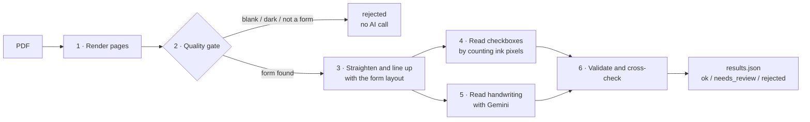

# Construction Form Digitizer

Turns scanned, handwritten **safety observation forms** into clean, validated JSON, and is honest about what it could not read.

```
Sample_input.pdf  ──►  python -m form_digitizer  ──►  output/results.json
```

| Page | What it is | Result | Why |
|---|---|---|---|
| 1 | Filled form | **ok** | Every field read; pixel count and AI agree on every checkbox |
| 2 | Filled form | **needs_review** | The AI read the location as **2000**; the pixel count read **1000** (correct). The disagreement is flagged instead of guessed. |
| 3 | Filled form | **ok** | Every field read; both readings agree |
| 4 | "FAILED TEST FORM" page | **rejected** | Not a form. Rejected **before** any AI call: no cost, nothing to hallucinate from. |

All values on pages 1–3 were checked by hand against the PDF.

---

## Contents

1. [Quick start](#1-quick-start)
2. [The idea in one picture](#2-the-idea-in-one-picture)
3. [Five rules behind every decision](#3-five-rules-behind-every-decision)
4. [How it works, step by step](#4-how-it-works-step-by-step)
5. [Resilience strategy: handling garbage input](#5-resilience-strategy-handling-garbage-input)
6. [How the AI is configured](#6-how-the-ai-is-configured)
7. [The output](#7-the-output)
8. [Cost and speed](#8-cost-and-speed)
9. [Project structure](#9-project-structure)
10. [Testing](#10-testing)
11. [What I learned while building it](#11-what-i-learned-while-building-it)
12. [Limitations and next steps](#12-limitations-and-next-steps)
13. [Task 2: P6 schedule classification](#13-task-2-p6-schedule-classification-architecture)

---

## 1. Quick start

Needs Python 3.10 or newer.

```bash
python -m venv .venv
# Windows: .venv\Scripts\activate      macOS / Linux: source .venv/bin/activate
pip install -e ".[dev]"
```

**Optional: add an API key.** Copy `.env.example` to `.env` and paste a free Google AI Studio key
(<https://aistudio.google.com> → *Get API key*). `.env` is git-ignored, so the key is never committed.

```
GEMINI_API_KEY=your-key-here
```

**Run it:**

```bash
python -m form_digitizer                      # reads data/Sample_input.pdf, writes output/results.json
python -m form_digitizer my.pdf -o out.json   # any other PDF
python -m form_digitizer --debug-dir output/debug   # also save each page and its straightened version
```

**No key? It still works.** The AI's replies for the sample PDF are saved in `output/cache/` and committed,
so the run reproduces the same results offline. On a new PDF without a key, checkboxes are still read
(that part uses no AI), text fields come back empty, and pages are marked `needs_review`.

---

## 2. The idea in one picture



Checkboxes are read **twice, independently**: once by counting pixels (step 4) and once by the AI (step 5).
Step 6 compares the two readings. Handwriting is read only by the AI, then checked for format.

---

## 3. Five rules behind every decision

1. **Never return a confident wrong answer.** An empty field with a flag is better than a plausible guess.
   Every value is either trusted or flagged for a person to check.
2. **Use AI only where it's needed.** Whether a box has an X in it is a pixel-counting problem, which is free,
   instant and repeatable. AI is used for the one thing it does best here: reading handwriting.
3. **Reject garbage before spending money on it.** Blank, black and non-form pages never reach the AI.
4. **Check everything twice.** Checkboxes get two independent readings. Text is checked for format
   (dates, ID numbers). The AI's reply is validated against a schema instead of being trusted.
5. **One bad page never stops the batch.** Every step is wrapped so a failure becomes a flagged page,
   not a crash.

---

## 4. How it works, step by step

### Step 1: Render pages ([`pdf_loader.py`](src/form_digitizer/pdf_loader.py))

Each page becomes a 200 DPI grayscale image: sharp enough for X marks and handwriting, small enough to be fast.
Pages are **streamed** one at a time, so a 500-page PDF doesn't have to fit in memory.
Any text built into the page is kept too. That's how page 4 identifies itself: it contains the text "FAILED TEST FORM",
while the real scans contain none.

### Step 2: Quality gate ([`quality.py`](src/form_digitizer/quality.py))

Four cheap measurements decide whether a page is worth processing:

| Measurement | What it is | What it catches |
|---|---|---|
| Ink ratio | Share of dark pixels | Blank pages (~0%), black or mud-covered pages (>70%) |
| Grid lines | Number of long straight lines, at any angle | Pages that aren't the form (page 4 has **0**; real forms have **~108**) |
| Sharpness | How much the image changes between neighbouring pixels | Blurry scans |
| Skew | Typical angle of those lines | Tilted pages (step 3 uses it) |

**The rule: if the form's table grid is still visible, process the page and flag what's wrong with it.
If it isn't, reject the page.** A muddy but readable form still produces data, and only the fields under
the mud come back empty.

### Step 3: Straighten and line up ([`alignment.py`](src/form_digitizer/alignment.py), [`layout.py`](src/form_digitizer/layout.py))

After this step, any given checkbox sits at the **same pixel position on every page**.

**Why not just overlay `template.jpg`?** I measured it. The template is a stretched 752×1600 phone image with
15 checklist rows. The real forms are A4 with 8–9 rows and a gap before the bottom section, so their
layouts don't match. Instead, every box position was **measured once on a clean real page** and stored
in [`layout.py`](src/form_digitizer/layout.py). Supporting a new form version means adding a layout there;
no pipeline code changes.

How a page is lined up:

1. Rotate by the skew from step 2. Also try 90°, 180° and 270°, which handles **sideways and upside-down scans**.
2. Crop to the outer edge of the form's table lines and resize to the standard frame (1654×2339).
3. **Fine-tune:** if the scan cut off a border, the crop is slightly wrong, so the known inner lines are
   snapped to their expected positions.
4. **Verify:** count how many of the 28 lines every form has appear where they should. Below 60%,
   the box positions aren't trusted (see "phone photo" in [section 5](#5-resilience-strategy-handling-garbage-input)).
5. Keep a **"seen" mask** of which parts of the form were actually inside the scan. A box outside the scan is
   reported as "not scanned", never as "empty".

### Step 4: Read checkboxes by counting ink ([`checkboxes.py`](src/form_digitizer/checkboxes.py))

For each box: what share of it is ink, after removing the box's own border lines?

| State | Rule | Flagged? |
|---|---|---|
| `empty` | ≤ 0.5% ink | no |
| `marked` | ≥ 1.2% ink (real X marks measure 2.5–3%) | no |
| `faint` | In between: too little to call | yes |
| `scribbled` | ≥ 30% ink: filled in or crossed out | yes |
| `unreadable` | The paper inside the box is dark (mud) | yes |
| `not scanned` | Part of the box is outside the scan | yes |

Each group (one checklist row, the location boxes, the shift boxes, each Yes/No/N-A row) gets **one answer**:
exactly one box marked → that's the answer; two or more → no answer, flagged; none → left blank.
The number of checklist rows varies by form (8 or 9 in the samples, up to 15), so rows are **detected** by
looking for their box borders.

### Step 5: Read the handwriting ([`extraction/`](src/form_digitizer/extraction/))

The straightened page is sent to **Gemini 3.5 Flash-Lite**, which reads the date, observer, company,
timesheet number, employee number, comments, the checklist title and questions, and the checkboxes (only
for the cross-check). Details are in [section 6](#6-how-the-ai-is-configured).

Every model sits behind one small interface, so they're interchangeable parts:

| Reader | When it's used |
|---|---|
| `CachedReader` | Always in front of the others. A page image is **never paid for twice**. |
| `GeminiReader` | When `GEMINI_API_KEY` is set. Retries with backoff; limits how many calls run at once. |
| `MockReader` | No key: reads nothing, invents nothing, and the page is flagged `text_not_read`. |

Adding OpenAI, Claude or a local OCR engine means adding one file in `extraction/`.

### Step 6: Validate and cross-check ([`validation.py`](src/form_digitizer/validation.py))

- **Checkboxes:** compare the pixel reading with the AI's reading.
  - They agree → trusted.
  - They disagree → the clean pixel reading is used (it's deterministic and calibrated) and the page is
    flagged `checkbox_mismatch`. That's what caught the AI's misread on page 2.
  - Pixels unsure, AI clear → the AI's answer is used, still flagged.
  - The AI gives a value that isn't on the form (e.g. location "9000") → dropped and flagged.
- **Dates:** parsed into ISO format (`2024-10-02`). An ambiguous date such as `02/10/2024` (2 October or 10 February?)
  is flagged rather than guessed, and so are future or pre-2000 dates. The original handwriting is kept in
  `observation_date_raw`.
- **ID numbers:** must be digits (spaces and dashes are dropped); anything else is flagged.
- **Required fields** (date, observer, company, employee number): flagged if blank. Comments are optional.

**Final status:** any *reject* issue → `rejected`; any *review* issue → `needs_review`; otherwise `ok`.

---

## 5. Resilience strategy: handling garbage input

The goal: a bad input must never **crash the pipeline**, and must never turn into **invented data**.
Each kind of failure is caught at the earliest, cheapest point:

| Garbage input | What happens | Status |
|---|---|---|
| File isn't a PDF, or is password-protected | Error recorded in `errors`, exit code 2, no crash | - |
| One page fails to render | That page is `render_failed`; the rest continue | rejected |
| Blank page | Ink ratio ≈ 0 → rejected **before any AI call** | rejected |
| Completely black or mud-covered page | Ink ratio > 70% → rejected before any AI call | rejected |
| Not the form (other document, test page) | No table grid found; page 4 is also caught by its "FAILED TEST" text | rejected |
| Dirty but readable page | Processed; boxes under mud become `unreadable`; the AI is told to return `illegible` instead of guessing | needs_review |
| Blurry scan | Processed and flagged | needs_review |
| Tilted, sideways or upside down | Straightened automatically | ok if all else is fine |
| Corner cut off by a tilted scan | "Seen" mask: boxes outside the scan are `not scanned`, never `empty` | needs_review |
| Phone photo taken at an angle | Line-up check fails → pixel reading skipped, checkboxes taken from the AI only | needs_review |
| Answer crossed out and re-marked | Scribbled box ignored, new mark used | needs_review |
| Two boxes ticked in one row | No answer chosen | needs_review |
| AI invents a value or breaks the schema | Reply rejected by validation; field left empty | needs_review |
| AI service down or overloaded | Retries with growing waits; if it still fails, flagged `model_error` and the run continues | needs_review |
| Unexpected bug on one page | Caught; page flagged `processing_error`; other pages continue | needs_review |

**How hallucination is prevented, layer by layer:**

1. Garbage pages are rejected before the AI sees them, so there's nothing to "read" into data.
2. The prompt orders the model to return `null` with a status (`blank`, `illegible`, `crossed_out`) instead of guessing.
3. The JSON schema limits answers to the codes printed on the form.
4. Temperature 0: the same image always gets the same answer.
5. The reply is validated with Pydantic; replies that break the schema are thrown away.
6. Checkboxes are cross-checked against pixel counting; any disagreement goes to a person.
7. Dates and ID numbers are format-checked.

### Proof: the stress test

[`scripts/stress_test.py`](scripts/stress_test.py) damages the sample pages on purpose and compares the
checkbox results with what's really on the forms. The column that matters is the last one: **wrong
answers that slipped through without a flag. It is 0 in every case.**

| Case | Quality gate | Aligned | Checkboxes correct | Flagged for review | Wrong, not flagged |
|---|---|---|---|---|---|
| Clean pages 1 / 2 / 3 | ok | yes (1.00) | 14/14, 14/14, 15/15 | 0 | **0** |
| Tilted 3° | ok | yes (1.00) | 12/14 | 4 | **0** |
| Tilted 8°, corner cut off | ok | yes (1.00) | 13/14 | 5 | **0** |
| Tilted 20°, side cut off | tilted (info) | yes (1.00) | 11/14 | 4 | **0** |
| Upside down | ok | yes (1.00) | 14/14 | 0 | **0** |
| Sideways | ok | yes (1.00) | 14/14 | 0 | **0** |
| Blurred | blurry | yes (0.82) | 13/14 | 1 | **0** |
| Light mud | ok | yes (1.00) | 11/14 | 8 | **0** |
| Medium mud | dirty_page | yes (0.96) | 9/14 | 10 | **0** |
| Heavy mud | dirty_page | yes (0.86) | 7/14 | 13 | **0** |
| Very heavy mud | rejected (too_dark) | - | - | - | - |
| Phone photo at an angle | passed | no (0.43) → AI-only, flagged | - | - | **0** |
| Crossed-out answer + double mark | ok | yes (1.00) | 12/14 | 2 | **0** |
| Blank page | rejected (blank_page) | - | - | - | - |
| Black page | rejected (too_dark) | - | - | - | - |
| Corrupted image | rejected (unreadable_image) | - | - | - | - |

"Checkboxes correct" counts the location, shift, every checklist row and the four Yes/No/N-A rows.
Lower numbers on damaged pages are expected: those boxes are **flagged**, not guessed.

---

## 6. How the AI is configured

| Setting | Value | Why |
|---|---|---|
| Model | `gemini-3.5-flash-lite` (change with `GEMINI_MODEL`) | Stable, takes images, one of the cheapest, free tier available. Copying text needs no reasoning model. |
| Input | Straightened page, shrunk to 1240 px wide, PNG | Enough detail for handwriting, fewer image tokens |
| Output | `response_mime_type="application/json"` + `response_json_schema` | Forces structured output |
| Temperature | 0 | Same image in, same answer out |
| Retries | Up to 4 attempts; waits 5, 10, 20 s plus a small random delay | Rides out "model overloaded" errors without retrying in lockstep. A bad key (401) is not retried. |
| Timeout | 120 s per call | The free tier was slow under load during testing |
| Parallel calls | At most 2 at once (`LLM_MAX_CONCURRENCY`) | Image work runs in parallel; API calls are capped separately |

**System prompt** (full text in [`extraction/schema.py`](src/form_digitizer/extraction/schema.py)), in short:
copy handwriting exactly (no spelling fixes, no expanding site slang); never guess; return `null` with status
`blank`, `illegible` or `crossed_out`; ignore crossed-out writing; copy dates as written; for checkboxes answer
`none` or `unclear` when there's no clear single mark; if the page isn't this form, set `is_safety_form: false`.

**Output schema** (built from the layout in `build_response_schema()`). Each text field is
`{value: string | null, status: ok | blank | illegible | crossed_out}`. The location, shift, checklist marks
and Yes/No answers are enums taken from the codes printed on the form, plus `none` and `unclear`.
The schema uses only plain JSON-Schema keywords, so it also works as an OpenAI structured-output schema or a
Claude tool schema.

**Privacy note:** on Google's free tier, submitted content may be used to improve Google's products; on the paid tier
it isn't. That's fine for these sample forms. For real site data I would use the paid tier (or Vertex AI).

---

## 7. The output

`output/results.json` holds a summary plus one record per page. Page 1, shortened:

```json
{
  "page": 1,
  "status": "ok",
  "issues": [],
  "form": {
    "observation_date": "2024-10-02",
    "observation_date_raw": "2024-10-02",
    "observer": "John Davis",
    "company_observed": "Summit Construction",
    "location_cwa": "8000",
    "shift": "Day",
    "timesheet_number": "25489",
    "employee_number": "7852",
    "checklist_title": "Breaking Containment - Life Saving Action",
    "checklist": [
      { "row": 1, "question": "Has the location to be cut or opened been visibly marked?", "rating": "I", "rating_label": "Imminent Hazard" },
      { "row": 4, "question": "Exclusion zone (e.g. barricade) is in place.", "rating": "R", "rating_label": "At Risk" }
    ],
    "expectations": [
      { "question": "Has positive feedback provided?", "answer": "Yes" }
    ],
    "comments": "Safety measures were strictly followed."
  },
  "quality":    { "ink_ratio": 0.0379, "sharpness": 1458.2, "grid_lines": 108, "skew_deg": 0.0 },
  "alignment":  { "aligned": true, "alignment_score": 1.0, "rotation_applied_deg": 0.0, "scanned_fraction": 1.0 },
  "extraction": { "source": "cache", "model": "gemini-3.5-flash-lite", "seconds": 0.0, "error": null }
}
```

When something needs a person, the page says exactly what and where. Page 2:

```json
"issues": [
  { "code": "checkbox_mismatch", "message": "pixel count says 1000, model says 2000",
    "severity": "review", "field": "location_cwa" }
]
```

A rejected page has `"form": null` and its reasons, e.g. `marked_void` and `no_form_grid` for page 4.

---

## 8. Cost and speed

- **One AI call per accepted page.** Rejected pages cost nothing.
- **The cache** means re-running never pays again. It's keyed by the image, model, prompt version and form layout,
  so changing the prompt automatically invalidates old replies.
- **Speed:** with cached replies, the whole sample PDF (4 pages) runs in about **3 seconds**, including Python
  start-up. A live AI call took **about 20–30 seconds per page** on the free tier during testing; pages run in parallel.
- **Memory:** pages are streamed, and at most `2 × MAX_WORKERS` pages are held at once.
- **At scale:** the next saving would be to send flagged pages to a stronger model only when needed, and to use the
  provider's batch API (cheaper, not real-time) for overnight jobs.

---

## 9. Project structure

```
├── .env.example                 settings template (copy to .env; .env is git-ignored)
├── pyproject.toml               dependencies, CLI entry point, pytest + ruff settings
├── data/                        Sample_input.pdf, template.jpg, P6_Schedule_Sample.xlsx
├── output/
│   ├── results.json             ← the deliverable
│   └── cache/                   saved AI replies (lets anyone re-run without a key)
├── scripts/stress_test.py       robustness report on deliberately damaged pages
├── src/form_digitizer/
│   ├── config.py                settings from .env / environment (key stored as SecretStr)
│   ├── layout.py                where every box is; one entry per form version
│   ├── models.py                output JSON shapes + one Issue type (reject / review / info)
│   ├── pdf_loader.py            step 1
│   ├── quality.py               step 2
│   ├── alignment.py             step 3
│   ├── checkboxes.py            step 4
│   ├── extraction/              step 5: schema.py (prompt + schema), gemini.py, mock.py, cache.py
│   ├── validation.py            step 6
│   ├── pipeline.py              runs the steps for every page, in parallel, never crashing
│   └── cli.py                   python -m form_digitizer
└── tests/                       50 tests, including synthetic tilted, muddy and crossed-out pages
```

### Settings (`.env`)

| Variable | Default | Meaning |
|---|---|---|
| `GEMINI_API_KEY` | (empty) | Google AI Studio key. Empty = no AI calls (cache still used). |
| `GEMINI_MODEL` | `gemini-3.5-flash-lite` | Model ID |
| `LLM_MAX_ATTEMPTS` | `4` | Tries per page before giving up |
| `LLM_TIMEOUT_SECONDS` | `120` | Per-call timeout |
| `LLM_MAX_CONCURRENCY` | `2` | AI calls in flight at once |
| `LLM_SEND_WIDTH_PX` | `1240` | Image width sent to the AI |
| `RENDER_DPI` | `200` | PDF rendering resolution |
| `MAX_WORKERS` | `4` | Pages processed in parallel |
| `CACHE_DIR` | `output/cache` | Where AI replies are saved |
| `LOG_LEVEL` | `INFO` | Logging detail |

Real environment variables override `.env`, the usual way to configure a server.

---

## 10. Testing

```bash
pytest                          # 50 tests, ~20 s, no network and no API key needed
python scripts/stress_test.py   # the robustness table in section 5
ruff check src tests scripts    # lint
```

The tests cover:
- every sample checkbox, compared with what's on the forms;
- each kind of garbage page being rejected;
- tilted, sideways, upside-down and cut-off scans;
- crossed-out answers and double marks;
- the exact request sent to Gemini (captured, never sent);
- retries on "overloaded" errors and no retry on a bad key;
- schema-breaking replies being rejected;
- the cache;
- date and number checks;
- the pixel-vs-AI cross-check;
- one crashing page not stopping a run;
- an unreadable PDF being reported, not raised.

---

## 11. What I learned while building it

- **The template didn't match the real forms.** Measuring both before writing code saved a lot of debugging:
  overlaying the template would have put every checklist box in the wrong place.
- **The stress test found a real bug.** Fake pages tilted 8° and 20° (so a corner fell outside the scan) produced
  wrong checkbox answers with **no flag**: boxes outside the scan read as "empty", and the crop shifted
  slightly. Two fixes followed: the "seen" mask, and fine-tuning the line-up on known inner lines. The stress
  test now shows 0 unflagged errors.
- **The AI is good, but not trusted blindly.** On page 2 it attached the X to the wrong location label (the box
  sits between "1000" and "2000"). The pixel reading knows which box belongs to which label, and the
  cross-check caught the error.
- **Free tiers get overloaded.** The first live run hit "model experiencing high demand" errors and timeouts.
  Short retry waits (2 s, 4 s) weren't enough. Growing waits with random jitter, a longer timeout and a cap on
  parallel calls got every page through.

---

## 12. Limitations and next steps

| Limitation | Next step |
|---|---|
| Phone photos taken at an angle are flagged, not corrected | Perspective correction: find the form's four corners and apply a homography |
| One form layout, measured by hand | Detect the form version automatically (e.g. by matching the header) and pick its layout |
| Accuracy measured on 3 real pages plus synthetic damage | Build a labelled set of real field scans and track accuracy per field |
| Blur detection is rough (scanner noise can hide blur) | A learned image-quality score |
| `needs_review` pages go nowhere yet | A small review screen; corrections feed back into thresholds and prompts |
| Every accepted page uses the same model | Try the cheap model first; send only flagged pages to a stronger one |
| `02/10/2024`-style dates are always flagged as ambiguous | Make the date order a per-site setting |

---

## 13. Task 2: P6 schedule classification (architecture)

*To be written next.* This section will cover how to classify 50,000+ P6 activity rows into the fixed
Discipline / Sub-Discipline taxonomy quickly and cheaply, without the AI inventing categories.
